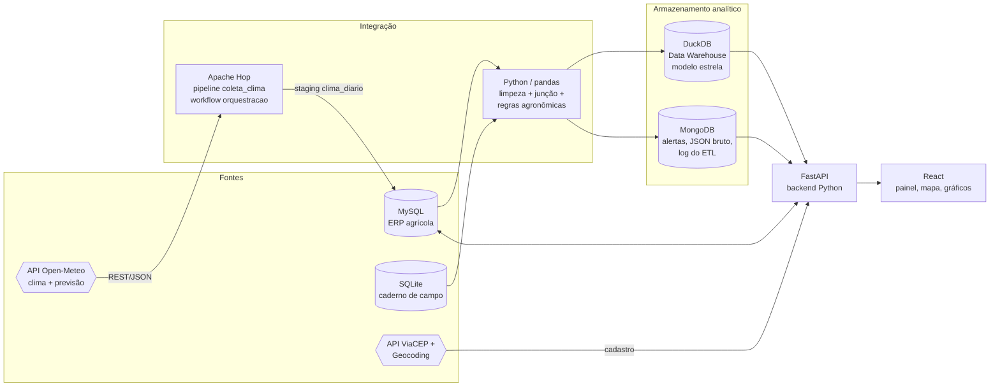

# 🌱 AgroSentinela

**Inteligência climática para o produtor rural da Média Mogiana (SP/MG)**

Desafio Final, disciplina **Integração de Dados**, UNIFEOB.

---

## 1. O problema

Na região de São João da Boa Vista, Vargem Grande do Sul, Espírito Santo do Pinhal, Caconde, Mococa e Andradas convivem o café arábica, a batata, o milho, a laranja e a cana. Quem produz nessa região toma todo dia decisões que dependem do clima:

* *Preciso irrigar hoje? Quanto?*
* *Vai gear esta semana? Preciso proteger as plantas jovens?*
* *O clima está favorável à ferrugem do café ou à requeima da batata?*
* *Qual é o melhor dia para pulverizar sem perder o produto com chuva ou vento?*

As informações para responder a essas perguntas **existem, mas estão espalhadas**:

| Onde está o dado | O que ele diz | Problema |
|---|---|---|
| Sistema da fazenda/cooperativa (**MySQL**) | talhões, culturas, áreas, irrigações, custos | não sabe nada do clima |
| Caderno de campo do técnico, app offline no celular (**SQLite**) | chuva do pluviômetro, pragas observadas | dados "sujos", digitados no campo |
| **API Open-Meteo** | temperatura, chuva, evapotranspiração, vento, umidade e previsão | não sabe o que está plantado nem onde |
| **API ViaCEP** | endereço completo e código IBGE a partir do CEP | só endereço |

Hoje o produtor olha cada fonte separadamente e decide no "achômetro". Na prática ele **irriga por rotina, até em dia de chuva**, e só percebe a doença quando ela já se instalou.

## 2. A solução

O AgroSentinela **integra as quatro fontes por talhão e por dia**, calcula indicadores agronômicos e entrega **recomendações acionáveis** num painel web:

* 💧 **Balanço hídrico do solo**: chuva efetiva + irrigação − consumo da cultura (ET0 × Kc) → *"Irrigar 45 mm (≈ 11.250 m³ para 25 ha)"*
* ❄️ **Risco de geada**: mínima prevista × limite de cada cultura, com recomendação específica
* 🍂 **Risco de doença**: temperatura média + umidade favoráveis à doença-chave da cultura
* 🐛 **Pragas**: infestação acima do nível de controle registrada no caderno de campo
* 🧪 **Janela de pulverização**: dias com vento < 15 km/h, sem chuva e com baixa probabilidade de chuva
* 💰 **Eficiência**: cruza as irrigações lançadas no ERP com a chuva do mesmo dia e mostra o **custo evitável**
* 📏 **Qualidade do dado**: compara o pluviômetro da fazenda com a estimativa da API e aponta divergências (chuva localizada ou pluviômetro com defeito)

## 3. Arquitetura



### Por que cada tecnologia (e não "só para cumprir requisito")

| Tecnologia | Papel | Por que ela |
|---|---|---|
| **MySQL** | Sistema transacional: produtores, propriedades, talhões, culturas, operações. Também guarda a *staging* `clima_diario` | Dados relacionais com integridade (FKs) e escrita concorrente pelo cadastro |
| **SQLite** | Caderno de campo do técnico (app offline) | Banco embarcado de um arquivo só, que é exatamente o que um app de celular sem internet usa |
| **MongoDB** | Alertas (documentos com estrutura variável por tipo), resposta JSON bruta da API, caderno bruto, registros rejeitados e histórico de execuções | Documentos JSON flexíveis. Guardar o dado bruto permite reprocessar (ideia de ELT/data lake) |
| **DuckDB** | Data Warehouse analítico em modelo estrela | Banco colunar para consultas analíticas (GROUP BY, janelas) direto de arquivo, sem servidor |
| **Apache Hop** | Pipeline visual de coleta (MySQL → REST → JSON → MySQL) e workflow de orquestração diária | Ferramenta de integração da disciplina. Agendável e visual |
| **Python (FastAPI + pandas)** | Limpeza, integração, regras agronômicas, carga e API REST | Requisito de backend e ótima biblioteca de transformação |
| **React (Vite + Recharts + Leaflet)** | Painel, mapa, gráficos, cadastro e acompanhamento do ETL | Requisito de frontend |
| **Open-Meteo / ViaCEP** | Clima histórico + previsão / enriquecimento de endereço | APIs públicas e gratuitas, sem chave |

### O pipeline de integração (7 etapas)

1. **Coleta** (Apache Hop *ou* coletor Python equivalente): para cada talhão ativo, chama a Open-Meteo e grava 30 dias de histórico + hoje + 7 dias de previsão na staging `clima_diario` (MySQL), com *upsert* por `talhao_id + data`.
2. **Extração**: lê cadastro, operações e clima (MySQL) e o caderno de campo (SQLite). Uma cópia fiel do caderno vai para o MongoDB (`bruto_caderno_campo`).
3. **Limpeza** do caderno de campo, com as técnicas vistas na disciplina: `TRIM/UPPER` em códigos (`" sjb-01 "`, `"SJB01"` → `SJB-01`), 3 formatos de data unificados, vírgula decimal, nomes de pragas padronizados (`"bicho mineiro"`, `"BICHO-MINEIRO "` → `BICHO-MINEIRO`), faixa válida (0–250 mm, nível 0–5), remoção de duplicatas de sincronização e rejeição de talhões inexistentes. Cada rejeitado vai para `rejeitados` (MongoDB) com o motivo.
4. **Integração**: junção por talhão e dia de clima + pluviômetro + irrigações (ERP) + pragas. Na **fusão de fontes**, o pluviômetro local tem prioridade sobre a estimativa da API, e o campo `fonte_chuva` registra a origem.
5. **Indicadores**: ETc, chuva efetiva, balanço hídrico sequencial, água disponível (% da CAD), riscos de geada e doença, janela de pulverização e graus-dia.
6. **Carga do DW (DuckDB)**: modelo estrela recriado a cada execução (grava em arquivo temporário e troca de forma atômica, então o painel não para).
7. **Alertas (MongoDB)**: um documento por recomendação, com o talhão embutido. O histórico da execução (etapas, contagens, tempos) vai para `execucoes_etl`.

### Modelo estrela (DuckDB)

```
                 dim_tempo
                     │
dim_talhao ── fato_clima_talhao   (talhão × dia: clima, balanço hídrico, riscos)
    │    └─── fato_operacoes      (operações do ERP: tipo, quantidade, custo)
    └──────── fato_pragas         (observações limpas do caderno de campo)
```

Views analíticas em [`database/duckdb/views_dw.sql`](database/duckdb/views_dw.sql): `vw_status_atual`, `vw_resumo_talhao`, `vw_pluviometro_vs_api`, `vw_custo_hectare`, `vw_chuva_municipio` e `vw_ranking_pragas`.

## 4. Estrutura do repositório

```
agrosentinela/
├── backend/                 API FastAPI + ETL em Python
│   ├── app/
│   │   ├── main.py          ponto de entrada da API
│   │   ├── config.py        lê o .env
│   │   ├── seed.py          cria tabelas e dados de demonstração
│   │   ├── db/conexoes.py   MySQL, SQLite, MongoDB e DuckDB
│   │   ├── services/
│   │   │   ├── apis_externas.py   Open-Meteo, Geocoding, ViaCEP
│   │   │   └── agronomia.py       regras de negócio (indicadores e alertas)
│   │   ├── etl/
│   │   │   ├── coleta_clima.py    coletor Python + disparo do Apache Hop
│   │   │   ├── limpeza.py         limpeza do caderno de campo
│   │   │   └── pipeline.py        orquestra as 7 etapas
│   │   └── routers/         endpoints (painel, cadastro, integração)
│   └── requirements.txt
├── frontend/                React (Vite)
│   └── src/pages/           Painel, Talhão, Análises, Cadastro, Integração
├── hop/                     projeto Apache Hop
│   ├── pipelines/coleta_clima.hpl
│   ├── workflows/orquestracao.hwf
│   ├── metadata/rdbms/agro_mysql.json   conexão (usa variáveis)
│   └── project-config.json              variáveis do projeto
├── database/
│   ├── mysql/01_schema.sql  schema transacional
│   └── duckdb/views_dw.sql  views do DW
├── scripts/                 instalar / carregar dados / iniciar (Windows e Linux)
├── dados/                   SQLite e DuckDB gerados (não versionados)
├── docker-compose.yml       MySQL + MongoDB prontos
└── .env.example
```

## 5. Como executar

### Pré-requisitos

* **Python 3.10+** e **Node.js 18+**
* **MySQL 8** e **MongoDB**. Duas opções:
  * com Docker: `docker compose up -d` (sobe os dois com usuário `root` / senha `root`)
  * sem Docker: MySQL Server/Workbench local e MongoDB Community (ou um cluster gratuito no **MongoDB Atlas**, colando a URI no `.env`)
* **Apache Hop 2.x** (opcional para rodar o sistema, necessário para demonstrar o pipeline). Veja a seção 6.

### Passo a passo (Windows)

```bat
scripts\1_instalar.bat         :: cria venv, instala dependências Python e Node, cria o .env
:: edite o .env com o usuário/senha do seu MySQL e a URI do MongoDB
scripts\2_carregar_dados.bat   :: cria tabelas, dados de demonstração e roda a 1ª integração
scripts\3_iniciar.bat          :: abre API (porta 8000) e frontend (porta 5173)
```

### Passo a passo (Linux/Mac)

```bash
scripts/instalar.sh
```

```bash
scripts/carregar_dados.sh
```

```bash
scripts/iniciar.sh
```

Depois acesse:
* **Aplicação:** http://localhost:5173
* **Documentação interativa da API (Swagger):** http://localhost:8000/docs

### Executando manualmente

```bash
cd backend
python -m venv .venv && source .venv/bin/activate      # Windows: .venv\Scripts\activate
pip install -r requirements.txt
python -m app.seed                  # estrutura + dados de demonstração
python -m app.etl.pipeline          # integração completa
uvicorn app.main:app --reload       # API em http://localhost:8000
```

```bash
cd frontend
npm install
npm run dev                         # http://localhost:5173
```

## 6. Apache Hop

O projeto Hop fica na pasta [`hop/`](hop/).

1. Baixe o Apache Hop em https://hop.apache.org/download/ e descompacte (ex.: `C:\hop`).
2. Copie o driver JDBC do MySQL (`mysql-connector-j-8.x.jar`, em https://dev.mysql.com/downloads/connector/j/ → *Platform Independent*) para `C:\hop\lib\jdbc\`.
3. Abra o Hop (`hop-gui.bat`), clique em **Projects → Add project**, nome `agrosentinela`, pasta `<repo>/hop`.
4. Em **Project → Edit**, ajuste as variáveis `MYSQL_USER`, `MYSQL_PASSWORD` etc. Para o workflow, `PYTHON` deve apontar para o Python do venv, ex.: `C:\...\agrosentinela\backend\.venv\Scripts\python.exe`.
5. Abra e execute:
   * `pipelines/coleta_clima.hpl`: **Table Input** (talhões + URL) → **REST Client** (Open-Meteo) → **Filter Rows** (HTTP 200?) → **JSON Input** (arrays diários → linhas) → **Insert/Update** (`clima_diario`). Falhas da API vão para **Write to Log**.
   * `workflows/orquestracao.hwf`: Start → Verificar MySQL → pipeline de coleta → **Shell** `python -m app.etl.pipeline --pular-coleta` → Sucesso (falhas → Registrar falha). O Start pode ser agendado (ex.: todo dia às 6h).

**Integração com o sistema:** preencha `HOP_HOME` no `.env` (ex.: `HOP_HOME=C:\hop`). A partir daí o botão **Executar integração** da tela *Integração* usa o Apache Hop (via `hop-run`) para a coleta e registra o projeto automaticamente. Com `HOP_HOME` vazio, o coletor Python faz a mesma coleta.

## 7. Principais endpoints

| Método | Rota | Descrição |
|---|---|---|
| GET | `/api/painel` | KPIs, situação de cada talhão e alertas atuais |
| GET | `/api/alertas?severidade=CRITICO` | alertas filtráveis (MongoDB) |
| GET | `/api/talhoes/{id}` | série diária, operações, pragas e alertas do talhão |
| GET | `/api/analises` | consultas analíticas do DW |
| GET | `/api/cep/{cep}` | ViaCEP + geocodificação Open-Meteo |
| POST | `/api/cadastro/propriedades` · `/talhoes` · `/produtores` | cadastro no MySQL |
| POST | `/api/etl/executar?cenario=geada` | dispara a integração (cenário opcional) |
| GET | `/api/etl/status` · `/execucoes` · `/rejeitados` · `/amostras` | acompanhamento e auditoria |
| GET | `/api/saude` | status de conexão dos 4 bancos e do Hop |

## 8. Cenário simulado de geada

Na tela *Integração* há a opção **"Simular frente fria"**. Ela aplica uma queda de temperatura entre o 2º e o 4º dia da previsão para testar os alertas de geada fora do inverno. Enquanto o cenário está ativo, o painel mostra um aviso. Para voltar aos dados reais, execute a integração com **"Dados reais"**.

## 9. Limitações e próximos passos

* As regras agronômicas são simplificadas (didáticas) e devem ser calibradas por um agrônomo para cada solo e variedade.
* Dados de produtores, operações e caderno de campo são **fictícios** (gerados pelo `seed.py`). Clima, CEP e coordenadas são **reais**.
* Próximos passos: alertas por WhatsApp/e-mail, imagens de satélite (NDVI), previsão de produtividade com machine learning e app offline real sincronizando o SQLite.
